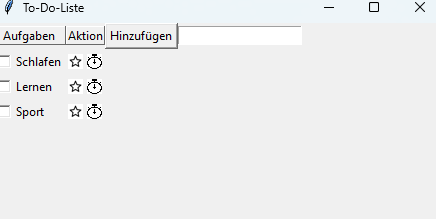

# To-do-Listen-Manager

## Beschreibung

Eine grafische Anwendung mit Tkinter zur Verwaltung von Aufgaben mit Funktionen zum Hinzufügen, Löschen, Priorisieren und Erinnern sowie Speicherung der Daten in einer JSON-Datei.

## Funktionen
 
- Aufgaben hinzufügen und löschen
- Aufgaben als erledigt markieren
- Aufgaben priorisieren
- Timer für Erinnerungen mit automatischer Benachrichtigung
- Dauerhafte Speicherung der Aufgaben und Erinnerungen
- Grafische Benutzeroberfläche mit Tkinter 

## Verwendete Technologien

- Python
- Tkinter (grafische Benutzeroberfläche)
- Pillow (Laden und Anzeigen von Bildern)
- JSON (Speicherung der Daten)
- datetime und timedelta (Berechnung von Zeitabständen)

## Installation

1. Repository herunterladen.
2. Python 3 installieren.
3. Pillow installieren:
pip install Pillow
4. Die Python-Datei ausführen.

> [!NOTE]
> Die benötigten Bilddateien müssen sich im selben Ordner wie das Python-Programm befinden.

## Verwendung

Nach dem Start öffnet sich die grafische Benutzeroberfläche.

Über das Eingabefeld und den Button „Hinzufügen“ können neue Aufgaben erstellt werden. Jede Aufgabe verfügt über drei Auswahlmöglichkeiten:

- Checkbox: Markiert eine Aufgabe als erledigt und entfernt sie anschließend aus der Liste.

- Sternsymbol: Verschiebt eine Aufgabe an den Anfang der Liste und priorisiert sie dadurch.

- Timersymbol: Aktiviert eine Erinnerung, die nach fünf Sekunden angezeigt wird.

Die Aufgaben und Erinnerungen werden automatisch in einer JSON-Datei gespeichert.

